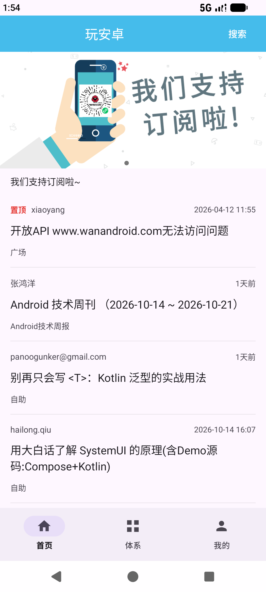
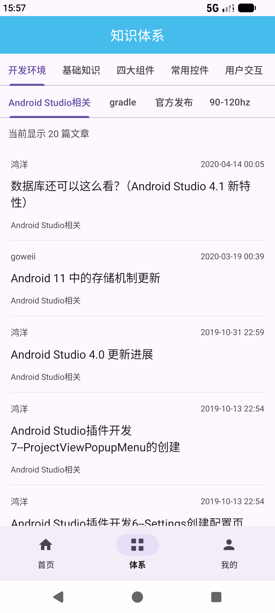
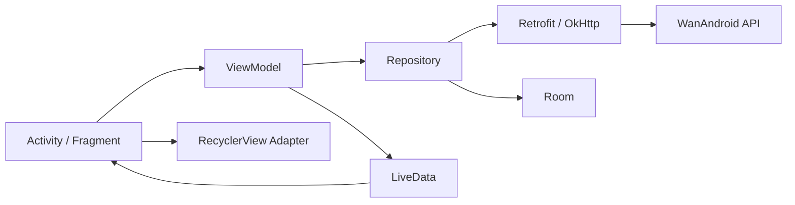

# WanAndroidLearn

基于 [玩安卓开放 API](https://www.wanandroid.com/blog/show/2) 的 Android 客户端，使用 **Kotlin + XML + ViewBinding** 开发，采用 **ViewModel、LiveData、Repository** 组织页面与数据。

支持文章浏览、搜索、知识体系、账号收藏、本地阅读历史和已读标记，覆盖从网络请求、页面状态管理到本地持久化的完整流程。

## 界面预览

| 首页 | 知识体系 |
|:---:|:---:|
|  |  |

截图来自模拟器中的实际页面，文章与 Banner 内容随玩安卓接口更新。

## 功能

| 模块 | 已实现内容 |
|---|---|
| 首页 | Banner 轮播、置顶文章、下拉刷新、分页加载、加载失败重试 |
| 文章阅读 | WebView 展示、加载进度、错误提示与重试、网页历史返回、浏览器打开、页面状态恢复 |
| 搜索 | 关键词搜索、热门搜索词、结果分页、切换关键词后重置列表 |
| 知识体系 | 一级/二级分类切换、分类文章展示与分页 |
| 账号 | 登录、登录状态检查、Cookie 会话保持、退出登录 |
| 收藏 | 阅读页收藏/取消收藏、我的收藏列表、分页、取消后的列表同步 |
| 阅读历史 | Room 保存、按最近阅读排序、重新打开、单条删除与清空 |
| 已读标记 | 首页、搜索和体系中的已读文章标题变灰，重启后保留 |
| 页面导航 | 首页、体系、我的三个底部入口，保留页面数据和滚动位置 |
| 常用网站 | 网站列表与网页打开 |

### 已读文章变灰

复用 Room 中的阅读历史，以“打开过文章”作为已读标准：

1. 进入阅读页后，保存文章链接、标题、阅读时间和文章 ID。
2. `ReadHistoryViewModel` 将历史链接映射为 `Set<String>`，通过 LiveData 提供给页面。
3. 页面把已读集合交给 `ArticleAdapter`，绑定条目时根据链接设置标题颜色。
4. 历史变化时，只通知已读状态发生变化的条目重新绑定。

已读状态与本机阅读历史保持一致，删除或清空历史后，对应文章恢复正常颜色。每次绑定都会设置已读或未读颜色，避免 ViewHolder 复用导致串色。

相关实现：[ReadHistoryViewModel](app/src/main/java/com/example/wanandroid/ui/history/ReadHistoryViewModel.kt)、[ArticleAdapter](app/src/main/java/com/example/wanandroid/ui/home/ArticleAdapter.kt)。

### 分页与状态处理

- 首页、搜索、体系和收藏列表均支持追加下一页，并按 ID 去重。
- 请求成功后推进页码，失败时保留已有文章与页码，重试同一页。
- 根据服务端 `over` 标记或原始文章列表为空判断结束。
- 搜索和体系切换条件时，取消旧任务并校验请求编号，避免旧结果覆盖新列表。
- 取消收藏后重新读取已加载的页，补回因服务端记录前移而可能遗漏的文章。

## 技术栈

| 类别 | 使用技术 |
|---|---|
| 语言与界面 | Kotlin、XML、ViewBinding、Material Components |
| 页面与状态 | Activity、Fragment、ViewModel、LiveData |
| 数据访问 | Repository、Kotlin Coroutines |
| 网络 | Retrofit 2.11.0、OkHttp 4.12.0、Gson |
| 本地存储 | Room 2.8.5、SharedPreferences |
| 列表与刷新 | RecyclerView、ConcatAdapter、SwipeRefreshLayout |
| Banner 与图片 | banner 2.2.3、ViewPager2、Glide 4.15.1 |
| 网页 | WebView、WebViewClient、WebChromeClient |
| 测试 | JUnit、AndroidX Test、Espresso |

## 代码结构

```text
app/src/main/java/com/example/wanandroid/
├── MainActivity.kt             # 底部导航与 Fragment 切换
├── ArticleActivity.kt          # 网页阅读、收藏与历史记录入口
├── WanApplication.kt           # 网络和数据库初始化
├── data/
│   ├── model/                 # 业务数据模型
│   ├── remote/                # Retrofit 接口、响应结构、CookieJar
│   ├── local/                 # Room 数据库、Entity、DAO
│   └── repository/            # 网络与本地数据访问
└── ui/
    ├── home/                  # 首页、Banner、文章 Adapter
    ├── search/                # 搜索与热门词
    ├── knowledge/             # 知识体系
    ├── collect/               # 文章收藏与收藏列表
    ├── history/               # 阅读历史与已读链接集合
    ├── login/                 # 登录与会话状态
    ├── mine/                  # 我的页面
    ├── website/               # 常用网站
    └── common/                # 分页底部状态与滚动监听
```

界面发起操作，ViewModel 管理数据与加载状态，Repository 负责数据访问。Activity / Fragment 观察 LiveData，再通过 ViewBinding 和 Adapter 更新界面。



## 运行项目

### 环境

以下版本与当前工程配置一致：

| 配置 | 版本 |
|---|---|
| Gradle 运行 JDK | 21 |
| Gradle Wrapper | 9.5.0 |
| Android Gradle Plugin | 9.3.3 |
| KSP | 2.3.12 |
| compileSdk | 37.1 |
| targetSdk | 36 |
| minSdk | 24，即 Android 7.0 |

Gradle 的运行 JDK 为 21，项目 Java 源码的兼容级别为 11。IDE 需要支持当前 Android Gradle Plugin 版本。

### Android Studio

1. 克隆仓库：

   ```bash
   git clone https://github.com/duang22/wanandroid.git
   cd wanandroid
   ```

2. 使用 Android Studio 打开仓库根目录。
3. 配置 Gradle JDK 21，通过 SDK Manager 安装 Android SDK Platform 37.1。
4. 完成 Gradle Sync，选择 `app` 配置，在 Android 7.0 及以上模拟器或设备运行。

接口地址已在 [ApiClient.kt](app/src/main/java/com/example/wanandroid/data/remote/ApiClient.kt) 配置。浏览功能可以直接使用，登录与收藏使用玩安卓账号。

### 命令行构建

在仓库根目录执行：

```bash
./gradlew :app:assembleDebug
```

生成的 Debug APK 位于 `app/build/outputs/apk/debug/app-debug.apk`。Windows 使用 `gradlew.bat` 执行相同任务。

## 测试

JVM 单元测试覆盖 Retrofit 请求参数、业务响应解析和接口错误处理：

```bash
./gradlew :app:testDebugUnitTest
```

设备测试覆盖首页刷新与分页、搜索和分类切换、收藏同步、底部导航、Room 阅读历史及已读颜色更新。启动模拟器或连接设备后执行：

```bash
./gradlew :app:connectedDebugAndroidTest
```

部分测试通过 Activity 创建前的回调注入示例服务，设备测试请使用 API 29 及以上系统；最近一次本地验证使用 API 37。首次执行可能需要下载设备测试依赖。

测试源码位于 [app/src/test](app/src/test) 和 [app/src/androidTest](app/src/androidTest)。

## 当前说明

- 阅读历史和已读标记保存在本机；网页正文通过 WebView 在线加载。
- 登录会话通过 OkHttp `CookieJar` 管理，持久化有效的持久 Cookie，退出时清理本地会话。
- 最近一次本地 `lintDebug` 检查报告了 Glide `NotificationTarget` 引发的 `NotificationPermission` 问题，该静态检查项仍待处理。


